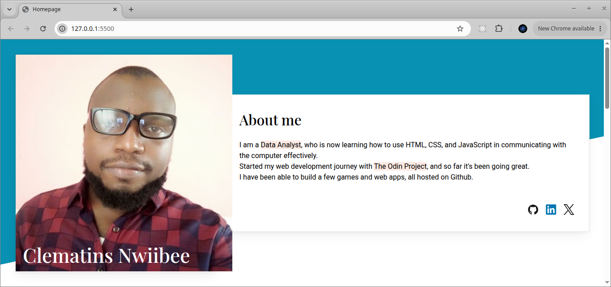

# Homepage

## Description:

- For this project I am tasked to build a very responsive and fluidy web application homepapge.
- The page would be designed in such a way, that it looks appealing both on mobile, tab and desktop resolutions.

## Tech Stack:

- HTML
- CSS

## App view

### Desktop View

### Tab view

### Mobile view (500px or less)

### Mobile view (600px or less)

## App

Kindly check out my homepage app
[Homepage](https://sorbari2016.github.io/home/)

## Future Refactor / Improvement
